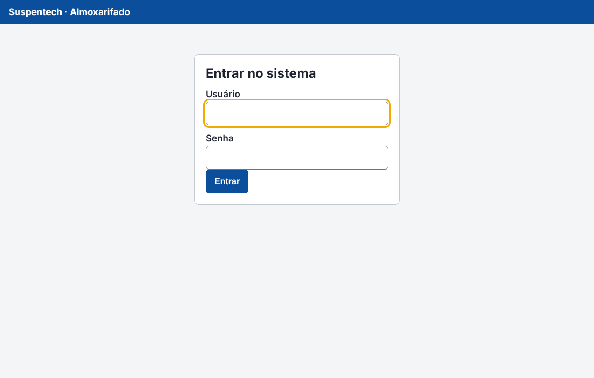
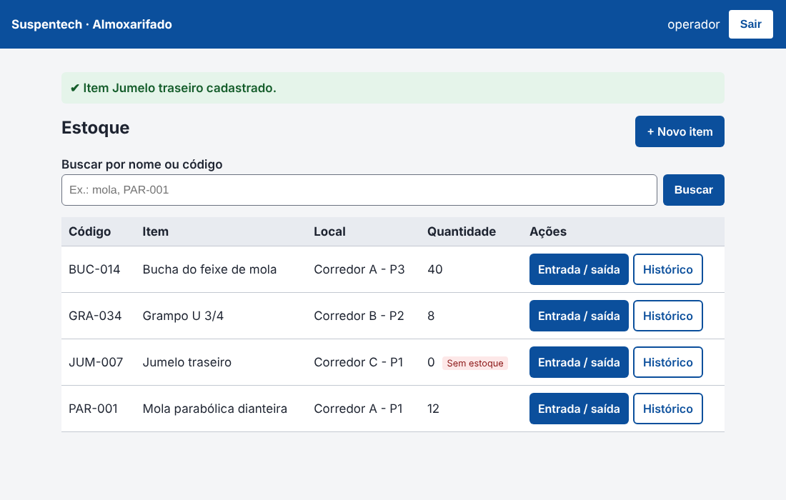
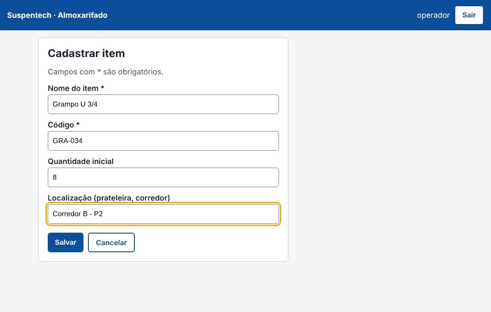
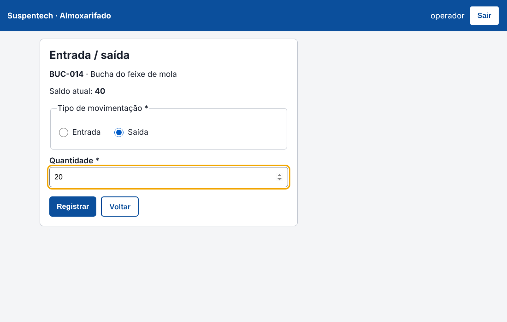
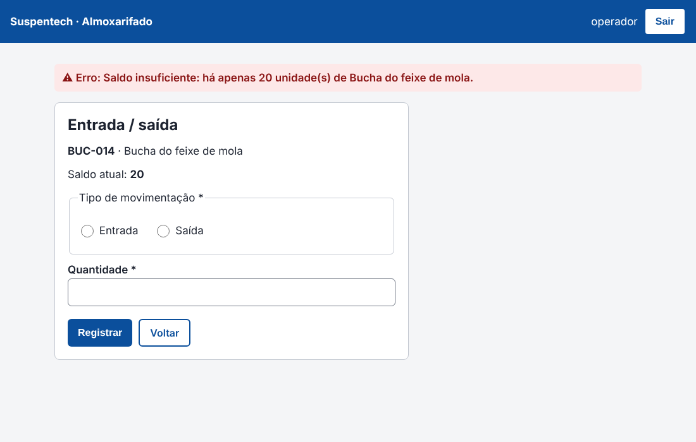
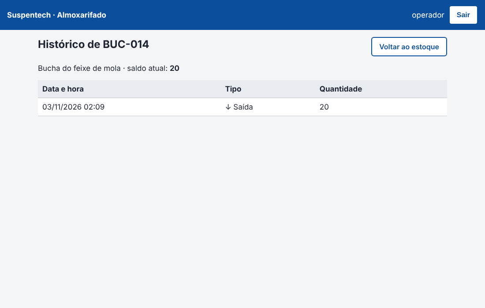

# Suspentech MVP - Sistema de Gestão de Almoxarifado


Projeto da disciplina de Projeto de Software (Experiência Prática III).

Hoje o controle do almoxarifado da Suspentech é feito em prancheta e planilhas soltas, o que gera erro de contagem e retrabalho. Este MVP é uma aplicação web simples para o operador registrar os materiais, dar entrada e saída e consultar o saldo de cada item.

## O que o sistema faz

| Requisito | Descrição | Situação |
|---|---|---|
| RF01 | Cadastro de item (nome, código único, quantidade inicial, localização) | feito |
| RF02 | Entrada e saída de material, atualizando o saldo e bloqueando saída maior que o saldo | feito |
| RF03 | Busca de itens por nome ou código | feito |
| RF04 | Histórico de movimentações de cada item | feito |
| RNF01 | Login obrigatório, senha guardada só como hash | feito |
| RNF02 | Proteção contra SQL Injection (ORM), XSS (escape do Jinja2) e CSRF | feito |
| RNF04 | Botões com no mínimo 44x44px, contraste alto, rótulos nos campos | feito |

## Tecnologias

- Python 3.12
- Flask 3.0 (rotas e telas)
- Flask-SQLAlchemy / SQLAlchemy 2.0 (acesso ao banco)
- SQLite (banco local)
- pytest (testes)
- GitHub Actions (integração contínua)

Arquitetura MVC: `app/models.py` (Model), `app/templates/` (View), `app/auth.py` e `app/estoque.py` (Controller). As regras de estoque ficam em `app/servicos.py`.

## Como rodar

```bash
python -m venv venv
venv\Scripts\activate          # no Windows
# source venv/bin/activate     # no Linux/Mac
pip install -r requirements.txt
flask --app run criar-usuario operador
flask --app run run
```

Depois é só abrir http://127.0.0.1:5000 e entrar com o usuário criado.

## Testes

```bash
python -m pytest -v
```

- `tests/test_servicos.py`: testes unitários das regras (cadastro, saldo, busca, hash da senha)
- `tests/test_rotas.py`: testes de integração (login, fluxo completo de cadastro e movimentação, CSRF, XSS)

Os testes rodam sozinhos no GitHub Actions a cada push e a cada Pull Request.

## Fora do escopo deste MVP

- Integração com ERP / nota fiscal
- Cadastro de fornecedores e categorias
- Leitura de código de barras

## Telas

| Login | Estoque | Cadastro |
|---|---|---|
|  |  |  |

| Entrada/saída | Saldo insuficiente | Histórico |
|---|---|---|
|  |  |  |
